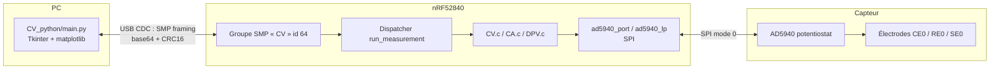

# ParisBioTek — Firmware nRF52840 + AD5940 & outil PC de voltampérométrie

Plateforme de **mesure électrochimique** sur nRF52840 (Nordic) piloté depuis un PC :
un microcontrôleur exécute les techniques (voltampérométrie cyclique, chronoampérométrie,
DPV) sur un potentiostat **AD5940**, et un outil Python les déclenche / récupère / trace
via USB — **sur le même canal que la mise à jour du firmware (DFU)**.

> Ce dépôt couvre le **firmware** et l'**outil PC**. L'application Android compagnon
> (authentification NFC + BLE) n'est pas nécessaire pour développer ici.

---

## 1. Aperçu



- Un **seul port USB (CDC ACM)** sert à la fois au **DFU mcumgr** et au **pilotage des
  mesures** (groupe SMP custom `id 64`). Un seul programme peut ouvrir le port à la fois.
- Les **logs / console** sortent sur **RTT (J-Link)**, jamais sur l'USB (sinon les trames
  SMP seraient corrompues).

---

## 2. Arborescence

```
firmware/                     ← ce dossier (projet NCS/Zephyr, sysbuild + MCUboot)
├── CMakeLists.txt
├── prj.conf                  ← config Bluetooth/NFC/USB/mcumgr + RTT
├── app.overlay               ← CDC SMP (DFU+mesures), SPI1 AD5940, GPIO, neutralisation DK
├── sysbuild.conf             ← active MCUboot dans le build multi-image
├── sysbuild/
│   ├── mcuboot.conf        ← recovery USB CDC
│   └── mcuboot.overlay     ← neutralise aussi les périphériques/broches DK dans le bootloader
├── flash.ps1                 ← flash USB DFU en 1 commande (upload→test→reset)
├── mcumgr-client.exe         ← client DFU série (0.0.9)
└── src/
    ├── main.c                ← USB/BLE/NFC + groupe SMP CV + dispatcher
    ├── methods.h             ← enum des techniques (CV=0, CA=1, DPV=2)
    ├── CV.c / CV.h           ← voltampérométrie cyclique (séquenceur AD5940)
    ├── CA.c / CA.h           ← chronoampérométrie (logiciel-timé)
    ├── DPV.c / DPV.h         ← voltamp. à impulsions différentielles (logiciel-timé)
    ├── ad5940_lp.c/.h        ← primitives boucle basse-puissance (LPDAC+LPTIA) + RTIA
    ├── RampTest.c/.h         ← moteur « ramp » ADI (utilisé par la CV)
    ├── ad5940.c/.h           ← pilote ADI AD5940
    └── ad5940_port.c/.h      ← portage SPI Zephyr + alimentation capteur

CV_python/                    ← outil PC (dossier voisin)
└── main.py                   ← GUI de pilotage / tracé / export
```

---

## 3. Matériel

| Élément            | Détail                                                              |
|--------------------|--------------------------------------------------------------------|
| Carte              | **PCB ParisBioTek nRF52840** ; cible Zephyr de base `nrf52840dk/nrf52840` |
| Capteur            | **AD5940** (potentiostat) sur **SPI1**, mode 0                      |
| Programmation      | **J-Link** (VCOM/RTT) *ou* **USB DFU** (mcumgr sur le CDC natif)    |
| Électrodes         | CE0 (contre-électrode), RE0 (référence), SE0 (travail), DE0         |

Câblage SPI (voir `app.overlay`) : `SCLK=P0.13  MOSI=P0.22  MISO=P0.15  CS=P0.17`,
reset `P0.20`, alim capteur `P1.00`.

`P0.08` pilote OE de **OSC1**, un oscillateur CMOS actif 32 MHz qui alimente
directement `XC1` du nRF52840. Il doit rester HIGH pendant toute la vie de
l'application : USB/BLE peut demander HFCLK à tout instant. Le build
`20260824-pwr-v4` l'abaissait après l'acquisition et figeait CPU/USB juste avant
le STATUS final ; cette image est bloquée par la GUI et ne doit plus être utilisée.
Le correctif d'horloge est présent depuis `20260824-clk-v5`. La version courante
`20260825-directinit-v8` le conserve, ajoute l'arrêt utilisateur et la
pré-polarisation au potentiel initial. Si le déclenchement manuel MMR de la
séquence Init ne démarre pas, cette initialisation unique est appliquée
directement par SPI ; les séquences ADC/DAC d'acquisition restent matérielles,
déclenchées par WUPT.

U5 est lui aussi un oscillateur actif, `OV-7604-C7` 32,768 kHz ±20 ppm, connecté
à XL1. L'application et MCUboot doivent donc être configurés en source LFCLK
externe full-swing, et non comme le quartz du DK.

La cible `nrf52840dk/nrf52840` sert uniquement de description de base du SoC et de
ses partitions internes : le PCB n'est pas un DK. Les overlays de l'application et
de MCUboot neutralisent explicitement le QSPI/MX25R, UART0, I2C0, PWM0, SPI3, les
LED et les boutons du DK. Ne pas retirer ces neutralisations : le QSPI hérité
revendique notamment `P0.17`, `P0.20` et `P0.22`, utilisés par l'AD5940. Dans
MCUboot, SPI1 est également désactivé car le bootloader n'en a pas besoin.

**Test « résistance »** (bring-up sans cellule réelle) : court-circuiter **CE0 et RE0**, puis
placer la résistance étalon entre ce nœud **CE0–RE0** et **SE0**. Laisser **DE0 ouvert**
(non connecté). Ne pas relier RE0 à SE0 : cela court-circuiterait l'entrée de mesure. Une CV
doit alors donner une droite `I = V/R`, dont la résistance estimée est proche de la valeur
étalon. Le RTIA est calibré via une **RCAL externe** (`CV_RCAL_OHM` dans `src/CV.h`) —
ajuster cette valeur à la RCAL réellement câblée pour la précision.

---

## 4. Prérequis logiciels

### Firmware — nRF Connect SDK **v3.3.0**
Installer via le **Toolchain Manager** de Nordic (ou l'extension *nRF Connect for VS Code*) :
- SDK : `C:\ncs\v3.3.0`
- Toolchain : `C:\ncs\toolchains\936afb6332`

`west` / `nrfutil` ne sont pas sur le PATH global : ouvrir un shell SDK avec
```powershell
nrfutil toolchain-manager launch --shell
```
ou simplement **ouvrir le dossier `firmware/` dans VS Code + nRF Connect** (build/flash en clic).

### Outil PC — Python 3.9+
```bash
pip install pyserial cbor2 matplotlib
```
(`tkinter` est fourni avec Python sous Windows.)

---

## 5. Compiler & flasher le firmware

> À faire dans un shell SDK (voir §4), depuis `firmware/`.

### Build
```powershell
west build -d build_2 -p always -b nrf52840dk/nrf52840   # 1re fois / après overlay
west build -d build_2                            # builds suivants (incrémental)
```

Après toute modification d'overlay, ne pas distribuer un ancien artefact. Dans
les DTS générés, vérifier : application `qspi=disabled`, `spi1=okay` sur
P0.13/P0.22/P0.15 ; MCUboot `qspi=disabled` et `spi1=disabled`. Dans les deux
`.config`, `CONFIG_NRFX_QSPI` doit être absent. Conserver aussi le SHA-256 de
`dfu_application.zip` livré.

Vérifier également dans les `.config` de l'application **et** de MCUboot :
`CONFIG_CLOCK_CONTROL_NRF_K32SRC_EXT_FULL_SWING=y`,
`CONFIG_CLOCK_CONTROL_NRF_K32SRC_20PPM=y` et `K32SRC_XTAL` absent.

> État du dossier au 24 août 2026 : le ZIP actuellement présent dans `build_2`
> contient encore `pwr-v4` et une limite CBOR de 64. Il est obsolète. Refaire le
> build pristine ci-dessus et confirmer `20260825-directinit-v8` avant tout flash.

### Flash — option A : J-Link (recommandé en dev)
```powershell
west flash -d build_2
```
Console + logs sur **RTT** : `JLinkRTTViewer` (ou l'onglet RTT de nRF Connect).

### Flash — option B : USB DFU (sans sonde)
Le port USB CDC natif expose le **serial recovery mcumgr**. `upload` écrit toujours dans le
slot secondaire : il faut ensuite `test` + `reset` pour booter l'image. Le script automatise tout :
```powershell
.\flash.ps1 -Port COM18       # adapter au COM du CDC natif
```
Le script vérifie l'identifiant embarqué avant tout upload et refuse explicitement
`intc-v3`/`pwr-v4`. Pour une version future, fournir son identifiant contrôlé avec
`-ExpectedBuild <identifiant>` ; le défaut attendu est `20260825-directinit-v8`.
> ⚠️ Fermer l'outil Python (§6) avant un DFU : **un seul propriétaire du port** à la fois.
> Après reset, MCUboot attend ~30 s (fenêtre DFU) avant de lancer l'application.

### Points de configuration à connaître (`prj.conf`)
- `CONFIG_UART_CONSOLE=n`, `CONFIG_LOG_BACKEND_UART=n` → **canal SMP propre** (logs sur RTT).
- `CONFIG_MCUMGR_TRANSPORT_UART=y` → DFU + groupe CV sur le CDC.
- `CONFIG_UDC_BUF_POOL_SIZE=16384`, `CONFIG_UDC_BUF_COUNT=32` → buffers USB (sinon
  « udc: Failed to allocate net_buf »).

---

## 6. Utiliser l'outil PC (`CV_python`)

```bash
cd CV_python
python main.py
```

Flux dans l'interface :
1. **Détecter** — sonde chaque port COM avec une requête SMP `STATUS` et retient celui qui
   répond (= le port DFU/mcumgr, le même que `flash.ps1`).
2. **Connecter**.
3. Choisir la **méthode** (voir §7), régler les paramètres et la **gamme RTIA**.
   En CV, `Stabilisation initiale` maintient le potentiel de départ avant le
   premier échantillon (`2000 ms` par défaut, `0` pour désactiver).
4. **▶ Lancer** — la mesure s'exécute sur la carte, les points sont téléchargés et tracés.
5. **■ Arrêter la mesure** demande un arrêt coopératif. Les points confirmés sont
   récupérés et peuvent être enregistrés ; ce choix opérateur n'est pas classé
   comme une erreur firmware.

Pour la CV, `Nombre de pas` et la durée calculée correspondent à **un cycle complet**
(départ → sommet → départ). `Cycles` répète ce triangle sans changer ces deux valeurs.
Le nombre total de points, `pas × cycles`, ne peut pas dépasser **4000** ; la durée totale
est approximativement `stabilisation initiale + durée par cycle × cycles`.
Le titre du graphique est en anglais ; les axes et le reste de l'interface
restent en français.

### Session / test & export
Renseigne un **nom de session** et un **nom de test** (+ **notes** libres avant la mesure).
À chaque mesure enregistrée :
```
CV_python/mesures/<session>/<test>/<test>_<AAAAMMJJ_HHMMSS>.csv
CV_python/mesures/<session>/<test>/<test>_<AAAAMMJJ_HHMMSS>.txt   ← méthode, params, résultat, notes
```
Colonne X du CSV : `voltage_mV` (CV/DPV) ou `time_ms` (CA). Pour une CV à plusieurs
cycles, une colonne `cycle` (numérotée à partir de 1) est ajoutée après `index`. Elle est
omise pour un seul cycle afin de conserver le format historique.

La GUI affiche par défaut la tendance moyenne séparément sur chaque branche et
chaque cycle de CV : médiane robuste sur environ 21 mV pour retirer les pics et
les petites salves, puis moyenne gaussienne centrée sur environ 45 mV. Ce mode
privilégie une courbe régulière plutôt que la conservation des variations rapides.
Le CSV conserve les colonnes brutes `current_nA/current_uA` et ajoute
`current_filtered_nA/current_filtered_uA`. La case du cadre **Mesure** permet de
réafficher immédiatement les données brutes.

---

### Journal et rapports d'erreur

Le journal de l'interface est horodaté à la milliseconde et conservé dans
`CV_python/journaux/ParisBioTek_<AAAAMMJJ>.log`. Les boutons **Copier** et
**Enregistrer…** permettent aussi de l'extraire directement depuis l'interface.

Après une **erreur**, les points déjà reçus restent affichés et trois fichiers sont
créés automatiquement dans `CV_python/mesures/<session>/<test>/` :

```
<test>_<horodatage>_ERREUR.txt
<test>_<horodatage>_ERREUR_diagnostic.json
<test>_<horodatage>_ERREUR_partiel.csv       # seulement si des points existent
```

Le rapport contient les paramètres, le dernier échange SMP, la chronologie des `STATUS`,
la LFOSC mesurée et utilisée, les erreurs SPI, l'état du port série Windows,
la phase exacte de lecture/écriture SMP, les drapeaux des deux contrôleurs
d'interruptions AD5940, les recharges du séquenceur et le traceback Python. Avec
`diag_ver=5`, il ajoute l'ADIID et le CHIPID réellement lus, l'ADIID obtenu dans
chaque mode SPI réellement essayé (`mode_tried`), le mode retenu, le premier code
d'erreur GPIO, l'état mémorisé de PWR/CS/RESET et `hfxo_on` (commande OE d'OSC1,
pas une mesure électrique). Les compteurs distinguent timeout d'écriture, erreur
de lecture, écriture partielle, CRC, bruit et réponse étrangère.

Un timeout isolé de `STATUS` est relancé jusqu'à trois fois : une trame perdue au
passage de la fin du cycle ne classe plus une mesure complète en erreur.

Avec `diag_ver=6`, le journal ajoute `settle_ms`, `stop_requested` et `cancelled`.
Un arrêt demandé par le bouton produit un CSV normal suffixé `_INTERROMPUE` et
une fiche `.txt`, sans rapport `_ERREUR`.

Le build `20260825-directinit-v8` ajoute `init_direct_fallback` : `1` signifie
que SEQ3 n'a pas démarré par MMR et que l'initialisation équivalente a été faite
par SPI, avant le lancement normal des séquences WUPT.

## 7. Techniques disponibles

| Méthode | id | Axe X | Paramètres principaux |
|---------|----|-------|-----------------------|
| **Voltampérométrie cyclique (CV)** | 0 | Tension (mV) | départ, sommet, Vzero, nb de pas/cycle, cycles, vitesse (mV/s), délai échantillon, stabilisation initiale |
| **Chronoampérométrie (i–t)**       | 1 | Temps (s)    | potentiel, Vzero, durée, intervalle |
| **DPV (impulsions différentielles)** | 2 | Tension (mV) | départ, fin, hauteur de marche, amplitude d'impulsion, durée d'impulsion, période |

- **RTIA** réglable (table 200 Ω → 512 kΩ) : fixe la fenêtre de courant `I_max ≈ 0,9 V / RTIA`.
  L'**auto-range** n'existe **que pour la CV** ; en CA/DPV, choisir une gamme fixe.
- CV = moteur séquenceur ADI (`RampTest.c`). CA & DPV = **logiciel-timés** (pilotage direct du
  LPDAC + lectures ADC ponctuelles via `ad5940_lp.c`), échelle de courant calibrée comme la CV.

---

## 8. Protocole SMP (pour développer côté firmware/PC)

Groupe custom **`id 64`** (`MGMT_GROUP_ID_PERUSER`), transport = SMP sur série (le même que le DFU).

| Cmd | Op | Payload entrée | Réponse |
|-----|----|----------------|---------|
| `START` (0)  | write | `method` + params entiers optionnels (voir ci-dessous) | `{rc:0, run_id, release_required:true, …}` |
| `STATUS` (1) | read  | `{}` | `{run_id, run, n, peak_na, r_ohm, rtia, method, stage, err, …}` |
| `DATA` (2)   | read  | `{run_id, off}` | `{run_id, off, n, v:[…], i:[…]}` (lots de 64) |
| `RELEASE` (3)| write | `{run_id, n}` | `{rc:0, run_id, n, released:true}` |
| `STOP` (4)   | write | `{run_id}` | `{rc:0, run_id, stop_requested, n}` |

`START` réserve atomiquement un `run_id`. Le même identifiant est exigé dans chaque
`DATA`, ce qui interdit de mélanger deux acquisitions. Après le dernier `STATUS` et le
téléchargement, `RELEASE` acquitte le nombre de points et rend le tampon au BLE ; un bail
de secours le libère après 60 s si le logiciel PC disparaît.
`STOP` ne fait aucune E/S AD5940 dans le handler USB : il arme un drapeau que le
thread de mesure consomme, puis les données partielles restent sous bail jusqu'à
`RELEASE`.

Clés `START` (toutes optionnelles, entiers) :
- **commun** : `method` (0/1/2), `vzero_mv`, `rtia` (CV : `0`=auto-range ; CA/DPV : `≤0`→4000)
- **CV** : `start_mv peak_mv steps cycles dur_ms delay_us settle_ms` (`steps` et
  `dur_ms` sont par cycle ; `steps × cycles ≤ 4000`; `0 ≤ settle_ms ≤ 60000`)
- **CA** : `ca_pot_mv ca_dur_ms ca_interval_ms`
- **DPV** : `start_mv end_mv dpv_estep_mv dpv_epulse_mv dpv_tpulse_ms dpv_tperiod_ms`

`v[]` = tension mV (CV/DPV) **ou** temps ms (CA) ; `i[]` = courant nA (ΔI en DPV).

Clés STATUS v5+ de la sonde AD5940 :

- `spi_mode=-1` si aucun mode n'est retenu ; sinon 0–3 ;
- `mode_ids01=M0|(M1<<16)` et `mode_ids23=M2|(M3<<16)`. M0 est toujours essayé ;
  M1–M3 ne le sont que si M0 ne vaut pas `0x4144`. `mode_tried` (bits 0–3)
  distingue une vraie lecture `0xFFFF` d'un mode non essayé ;
- `hfxo_on=true` confirme que la dernière commande OE d'OSC1 a réussi. Ce champ
  est un latch logiciel, pas une mesure de la présence physique du 32 MHz ;
- `gpio_state` bits 0/1/2 = PWR/CS/RESET commandés actifs, bits 8/9/10 = latches
  de sortie hauts. C'est un instantané nRF avant la première sonde SPI, pas une
  mesure électrique. Une initialisation mode 0 normale donne `gpio_err=0`,
  `gpio_state=0x701` et `adiid=0x4144`.
- en v6, `settle_ms` confirme la pré-polarisation retenue ; `stop_requested`
  indique la demande coopérative et `cancelled=true`, avec `stage=cancelled` et
  `err=0`, distingue un arrêt utilisateur d'une panne.

Framing (implémenté dans `main.py`, identique à `serial_util.c` de Zephyr) : marqueur
`0x0609` (1er fragment) / `0x0414` (suivant), base64 de `[len BE 2o][paquet][CRC16 BE 2o]`,
terminé par `\n` ; CRC16-ITU-T/XMODEM (poly `0x1021`, init `0`) ; en-tête SMP `op,flags,len,group,seq,id`.

---

## 9. Étendre

- **Nouvelle technique** : créer `XXX.c/.h` sur le modèle de `CA.c` (utilise `ad5940_lp`),
  ajouter une valeur à `methods.h`, un `case` dans `run_measurement()` (`main.c`), décoder ses
  clés dans `cv_mgmt_start`, l'ajouter à `CMakeLists.txt`, puis un panneau de paramètres dans
  `main.py` (`_build_*_params` + `_read_params`).
- **Précision courant** : ajuster `CV_RCAL_OHM` (`src/CV.h`) à la RCAL réelle.

---

## 10. Dépannage

| Symptôme | Cause / solution |
|----------|------------------|
| Python « Aucune carte détectée » | Mauvais port, ou port tenu par un autre logiciel (mcumgr, terminal série, GUI en double). Fermer les autres, réessayer. |
| Accès au port refusé / freeze | Le port DFU est déjà ouvert ailleurs — un seul propriétaire à la fois. |
| DFU « ne reconnaît pas la commande » | Fermer le GUI Python avant `flash.ps1` ; vérifier le bon COM (CDC natif, pas la VCOM J-Link). |
| `err=-10`, `stage=*/platform_init`, 0 point | L'AD5940 ne répond pas avant toute CV. Flasher `20260825-directinit-v8`, puis lire ADIID/CHIPID, `mode_tried`, les identifiants de mode et `gpio_state`. Si les modes réellement essayés valent `0000`/`FFFF` avec `spi_errors=0`, mesurer VOUT1, AVDD, DVDD/IOVDD, RESET et MISO ; le RTIA et la vitesse ne sont pas en cause. |
| `pwr-v4`, timeout d'écriture dans les derniers points | Panne connue : cette image coupe OE d'OSC1 sur P0.08 et fige CPU/USB avant `run=false`/RELEASE. Ne pas relancer de mesure ; reconstruire et flasher `20260825-directinit-v8` (correctif présent depuis `clk-v5`). |
| Rien sur la console série | Normal : logs sur **RTT** (`CONFIG_UART_CONSOLE=n`). |
| `west`/`nrfutil` introuvable | Ouvrir un shell SDK (`nrfutil toolchain-manager launch --shell`) ou VS Code + nRF Connect. |
| SWD/flash refusé (APPROTECT) | `nrfutil device recover --serial-number <sn>` puis `west flash`. |

---

### Codes d'arrêt de mesure

Les firmwares récents exposent `diag_ver=6`, `run_id`, `stage`, `err_detail` et les
compteurs de diagnostic dans `STATUS`. La version 3 ajoute le contrôle des lectures
`INTC0/1` (`intc_stale`, retries et confirmation des fautes) ainsi qu'un instantané
`SEQCON`/`SEQCNT`/`SEQTIMEOUT` et `SEQ0/1/2INFO` lorsqu'une faute séquenceur est
confirmée. La version 4 ajoute `chipid`, `spi_mode`, `mode_ids01`, `mode_ids23`,
`gpio_err` et `gpio_state` pour distinguer une erreur de commande GPIO, un AD5940 muet
et une vraie erreur du contrôleur SPI. La version 5 ajoute `mode_tried` et `hfxo_on`
pour supprimer l'ambiguïté des emplacements `0xFFFF` et surveiller la commande OE
d'OSC1. La version 6 ajoute STOP, `settle_ms`, `stop_requested` et `cancelled`.
`spi_errors=0` signifie seulement que le nRF52840
a terminé les transferts ; ce n'est pas un acquittement de l'AD5940. Les principaux
codes `err` sont :

| Code | Signification |
|------|---------------|
| `-10` | alimentation ou initialisation de plateforme AD5940 impossible |
| `-11` | ADIID perdu ou incorrect lors du contrôle post-initialisation |
| `-12` | erreur de l'API/du contrôleur SPI, y compris suspend/reprise |
| `-20` / `-21` | initialisation ou démarrage CV impossible |
| `-22` | erreur du service séquenceur/FIFO |
| `-23` | aucun nouveau point pendant le délai de surveillance |
| `-24` | échéance globale de la CV dépassée |
| `-25` | fin reçue avec un nombre de points incomplet |
| `-26` | application/lecture de contrôle du potentiel initial impossible |
| `-30` / `-40` | échec CA / DPV |

`platform_err=-100` est la sentinelle ADI `AD5940ERR_APPERROR` utilisée ici
lorsqu'aucun mode SPI ne donne `0x4144` ; ce n'est pas un errno Zephyr.

Une calibration LFOSC hors de la plage plausible est désormais signalée dans le journal
et remplacée par la valeur sûre de 32 kHz. Une erreur SPI n'est plus masquée par un timeout
générique : la mesure est arrêtée immédiatement avec son code et sa phase.

Sur la carte actuelle, GP0/INT de l'AD5940 n'est pas routé vers le nRF52840 : la CV est
servie par polling. Pendant un run, le firmware verrouille donc l'hibernation afin qu'un
premier accès SPI ne puisse pas relire par erreur la clé `SEQSLPLOCK` (`0xA47E5`) à la
place d'`INTC0`. Toute faute fatale doit en plus persister sur une seconde lecture avant
d'arrêter la mesure.

## 11. Notes / limites

- CA & DPV sont **logiciel-timés** (précision d'impulsion ≥ ~10–50 ms) — une version
  séquenceur (plus rapide/précise) reste à faire.
- L'**auto-range** est réservé à la CV.
- Le NFC/BLE (app Android) reste fonctionnel mais hors périmètre de ce README.
